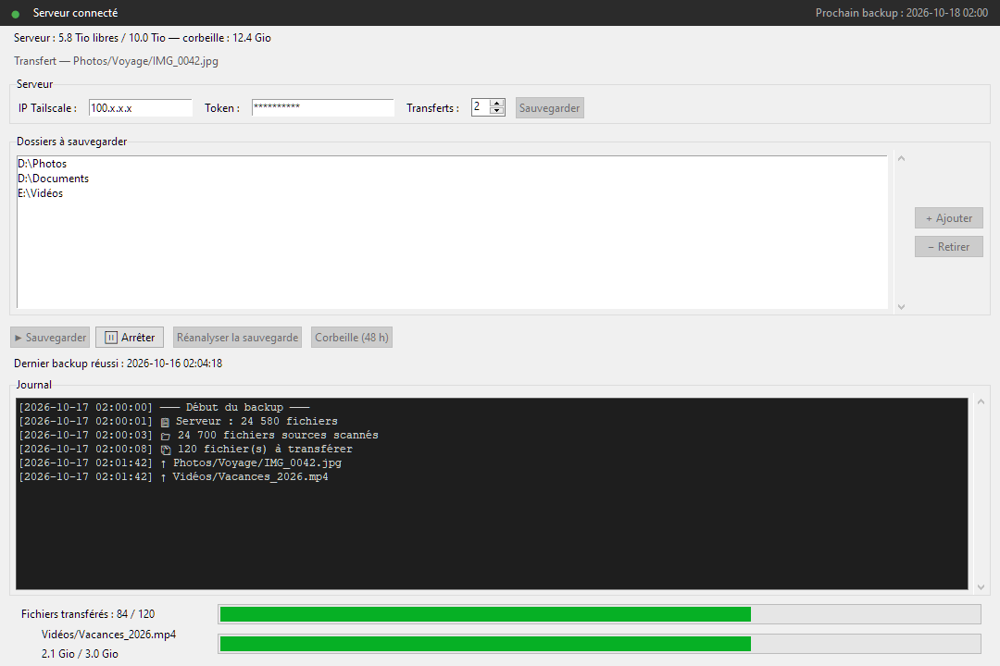

# FCS Backup

**Skip expensive cloud backup subscriptions. Automate offsite backups on your own hardware.**

Back up your files to a second Windows PC at another location, connected privately through Tailscale. FCS Backup preserves your filenames and folder structure, verifies transfers, and runs daily backups without a backup provider subscription.

*Actual application interface with demonstration data.*

## Features

- **Automated offsite backups** — daily scheduling and a Windows notification-area icon.
- **Efficient transfers** — unchanged content is skipped; interrupted uploads can resume.
- **Verified file updates** — SHA-256 checks and atomic replacement protect the previous copy until the new one is validated.
- **48-hour recovery** — restore deleted files from server-side trash through the client.
- **Live visibility** — transfer progress, available storage, and an activity log.

## Get started

Follow the **[installation guide](INSTALL.md)** to configure the server, connect the client, and run your first backup.

FCS Backup mirrors your selected folders. Source deletions move backup copies to a 48-hour trash before permanent removal. Restored files must also be copied back to their source to survive the next mirror.

See the [validation report](TEST_REPORT.md) for test results and the [design decisions](DECISIONS.md) for technical details.

## License

Released under the [MIT License](LICENSE). Copyright © 2026 Sébastien Bédard.

---

The interface and source code are in French.

**Conçu par Sébastien Bédard**
